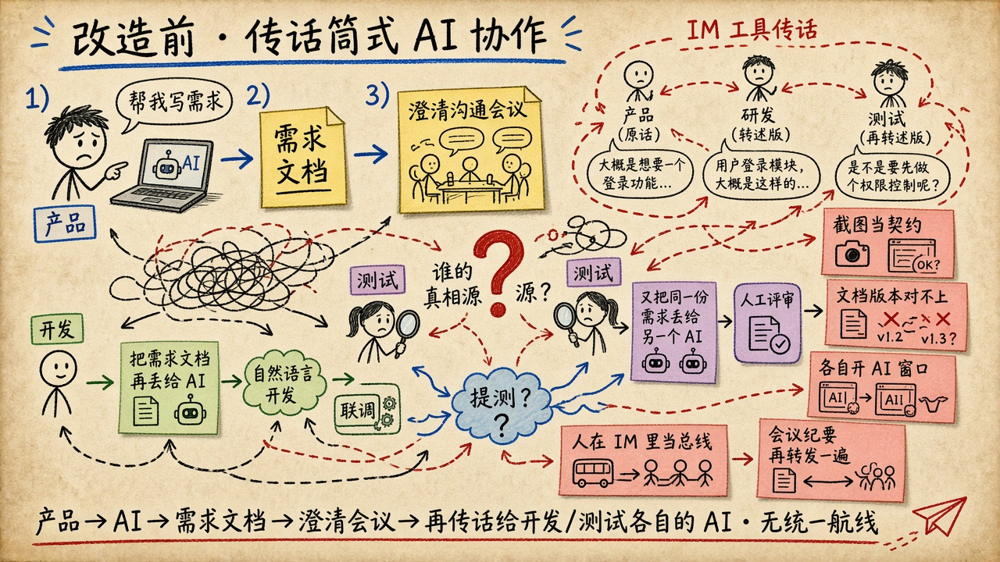
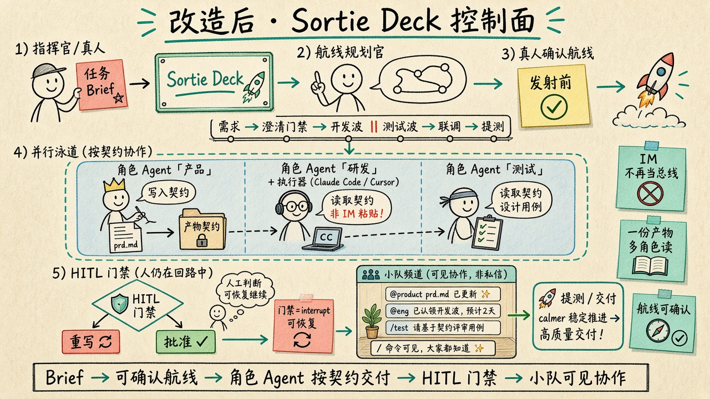

# What problem does this project solve?

Sortie Deck is not about “adding AI”. It targets teams that **already use AI**, yet still use humans as a **telephone over IM**.

## The problem in one line

Product, eng, and QA each open private AI chats; requirements get forwarded; clarification minutes get re-forwarded; screenshots become contracts — the source of truth shatters, the pipeline is invisible, and gates are not auditable.

## Before (the pain)

Typical path:

1. **Product** → AI → **requirements doc**
2. **Clarification meeting** (minutes re-forwarded via **IM tools**)
3. Dev / QA **each** dump the same doc into their own AI
4. Integration and release still rely on **IM relays**

> Product → AI → requirements → clarification → IM relay → each side’s AI → ready for test?

## After (how Sortie Deck answers)

| Problem | Answer |
|---------|--------|
| IM as the bus; humans as the telephone | Squad rooms for visible collab; IM is not the source of truth |
| Private AI windows + paste relays | Mission-scoped role agents + pluggable executors |
| Screenshots / chat as contracts | Named artifact files; downstream reads files |
| Oral “pipeline” agreements | Brief → planner proposes → **human confirms** → launch |
| Group @ as a gate | LangGraph `interrupt()` HITL (resumable, auditable) |

> Brief → confirmable pipeline → role agents deliver by contract → HITL → visible squad collab → ship

## Related

Narrative and landing points: [Transformation plan](transformation.md).
