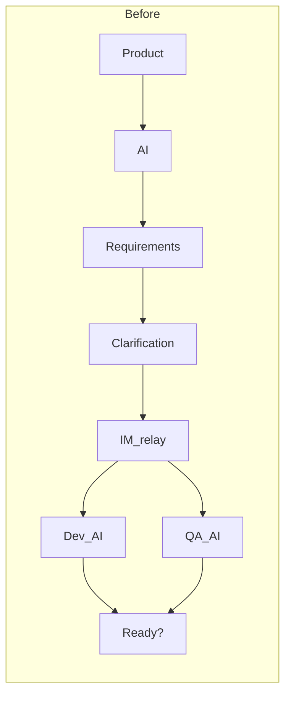
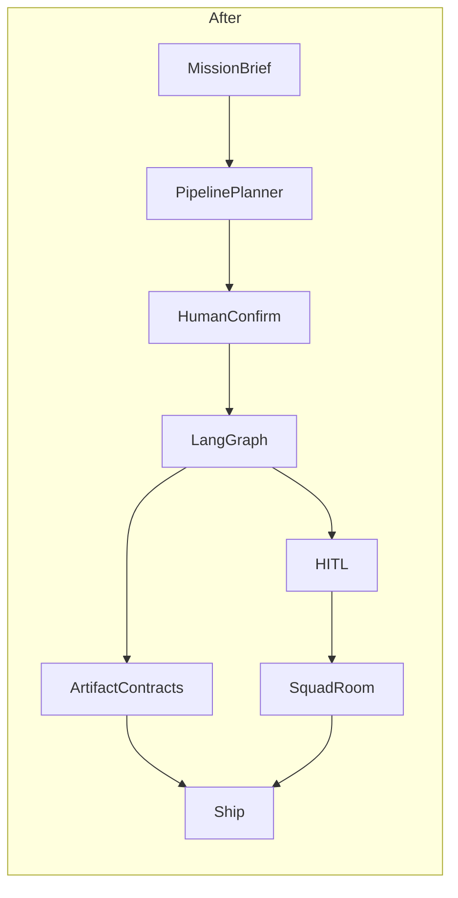

# Transformation plan

Sortie Deck’s thesis is simple: **office iteration should not use humans as a telephone**.  
AI is already in the loop — but if IM tools remain the bus and everyone opens a private chat window, the source of truth shatters into pasted fragments.

This page contrasts **before** and **after** with two hand-drawn scenes.

## Before: telephone-style AI collaboration

The path “uses AI”, but the bus is still people + IM:

1. **Product** → opens AI → produces a **requirements doc**
2. Runs a **clarification meeting** (minutes re-forwarded over IM)
3. After the fork, **dev and QA each** dump the same doc into their own AI
4. Integration, review, and release still rely on **IM relays** and screenshots-as-contracts

Pain: no shared pipeline, no artifact contracts, gates = “@ me in the group”, versions diverge.

### Before in one line

> Product → AI → requirements doc → clarification meeting → IM relay → each side’s AI → ready for test?

## After: Sortie Deck control plane

Replace chat relays with a **confirmable pipeline + artifact contracts + HITL gates**:

| Before | After |
|--------|-------|
| IM as the bus | Squad rooms for visible collab; IM is not the source of truth |
| Private AI windows | Mission-scoped role agents + pluggable executors |
| Paste / screenshots as contracts | Named artifact files; downstream reads files, not chat |
| Meeting notes re-forwarded | Brief → pipeline planner proposes → **human confirms** → launch |
| Group @ as a gate | LangGraph `interrupt()` HITL (approve / rewrite / reject) |

### After in one line

> Brief → confirmable pipeline → role agents deliver by contract → HITL gates → visible squad collab → ship

## Skeleton (text)

## Where it lands in this repo

- Pipeline: propose → confirm → compile ([Pipeline](../modules/pipeline.md))
- Graph & gates: [Graph HITL Contracts](../modules/graph.md)
- Squad: [Squad Rooms](../modules/rooms.md)
- Artifacts: [Artifacts](../modules/artifacts.md)
- Architecture: [overview](../architecture/overview.md)

## Principles that stay fixed

1. **Control plane, not another chatbot**
2. **Contracted artifacts** — downstream reads files
3. **Human-in-the-loop** — pausable, resumable, auditable
4. **Confirmable pipelines** — humans decide before launch
5. **Composable loadout** — agents / toolkits / memory per mission
