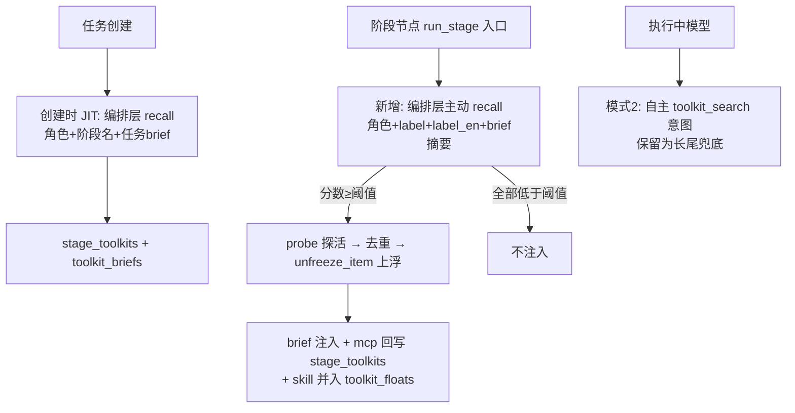

# 计划：阶段入口主动召回工具注入

- 日期：2026-10-21
- 状态：已确认，实施中
- 关联：`docs/plans/2026-10-20-tool-search-meta-tool.md`（模式 2 元工具）、`docs/工具箱-tool-skill-mcp-执行流程调研.md`（流程调研）、`src/sortie_deck/loadout.py`（模式 1 JIT 装载）

---

## 1. 需求背景

当前能力供给只有两条路径：

1. **绑定注入**（role/state 预绑定 → brief 常驻）：确定性最高，但依赖用户提前知道要绑什么；
2. **模式 2 元工具**（执行中模型自主 `toolkit_search`）：覆盖长尾，但有三个漏洞——
   - 未绑定条目**连名字都不在上下文**，模型没有"库存意识"，可能想不到去搜（"召回失败即静默缺失"）；
   - harness 每阶段**单轮对话**（executor.py:8），`toolkit_search` 结果在回复完成后才解析回 brief，单趟不重入的阶段**永远消费不到搜索结果**（search→pick 跨轮才能闭合）；
   - 召回质量取决于模型 query，而它对库里有什么毫无先验。

目标：补一层**编排层主动召回**——任务创建时与每个阶段入口，由编排层直接调 `recall()`（不经模型），把匹配到的 tool/mcp/skill 自动注入当前阶段上下文；无匹配不注入。

## 2. 业内调研（真实来源，延续 2026-10-20 调研结论）

| 来源 | 做法 | 对本方案的印证 |
|------|------|----------------|
| Claude Code Tool Search（[MCP 文档](https://code.claude.com/docs/en/mcp)） | 分层披露：Tier 0 裸名常驻 + `alwaysLoad: true` 常驻 + search 按需解冻 | 主动供给优于纯自主发现；本方案 = 把 `alwaysLoad` 变成按任务语义自动计算 |
| RAG-MCP（[arXiv 2505.03275](https://arxiv.org/abs/2505.03275)） | 任务文本检索 top-k 工具注入；200 工具全量注入准确率 13.6% → 检索 top-10 后 43%+ | "按任务语义检索注入"有效且显著优于全量注入 |
| OpenAI Agents JS（[tools 文档](https://openai.github.io/openai-agents-js/guides/tools)） | `deferLoading` + `toolSearchTool()` | 延迟披露与主动召回可并存，分层供给是主流形态 |
| MCP Gateway 模式（[Arcade](https://www.arcade.dev/blog/mcp-gateway-pattern)） | 授权集中在编排层一处 | 本方案沿用：注入/执行仍过 probe、白名单、确认门 |

与项目既有约定（CLAUDE.md）的兼容：编排层集中授权、HITL 确认门、最小权限 allowlist、fail-soft 均已存在，本方案只增加"供给入口"，不改授权模型。冲突点：无。

## 3. 技术设计

### 3.1 三层能力供给体系



### 3.2 关键设计决策

1. **编排层直接召回，而非"强制模型调 toolkit_search"**：确定性、零模型成本、无跨轮时间差。
2. **"无需则不调用" = 分数阈值**：新增 `loadout_recall_min_score`（默认 0.2），召回分数全低于阈值即不注入；不做"要不要搜"的预判（recall 本身是廉价操作：本地词元打分无 LLM 调用，或一次 WeKnora hybrid_search）。
3. **幂等**：`PipelineState` 新增 `stage_recall_done: dict[str, bool]`，每阶段只主动召回一次；重试 / HITL 重入命中即跳过。
4. **注入的闭环落点**（与 pick 意图对齐）：
   - tool → 只进 brief（端点文本，无执行通道）；
   - mcp → 回写 `stage_toolkits[stage]`（`_run_mcp_calls` 可真实建会话调用，沿用 `merge_picked_toolkits` 模式 graph.py:252-273）；
   - skill → 并入 `toolkit_floats[stage]`（满足 `skill_run` 的"先 pick"校验 graph.py:312-318，模型可直接执行脚本）。
5. **预算复用**：单 need ≤5 条（`SEARCH_TOP_K`）、每阶段 2 个 need ≈ ≤10 条；skill 正文上浮走既有 `SKILL_BODY_FLOAT_LIMIT`（5000 字符）截断；不新增预算键。
6. **开关**：新增 `loadout_stage_recall: bool = True`（关闭时零行为变更）；`loadout_recall_min_score: float = 0.2`。
7. **创建时 JIT 增强**：`_apply_dynamic_loadout` 的 `CapabilityNeed` 目前只有"角色+节点名 / 阶段标签"，补任务 brief 摘要（前 300 字符）进 capability 文本，提高与任务语义的匹配度。

### 3.3 阶段入口召回算法（graph.run_stage 内新 helper）

```
输入: state, stage, role, cfg(阶段 label/label_en), brief
1. 幂等检查: state["stage_recall_done"] 命中 stage → 返回空
2. 开关检查: settings.loadout_stage_recall 为 False → 跳过
3. 查询构造（实施中演进：多路聚焦短查询，见下方"设计演进"）:
   ① role + stage 名   ② 阶段 label + label_en   ③ brief 摘要(≤300 字符)
4. 每路 recall(store, query=..., allowed_ids=org_policy 白名单, limit=SEARCH_TOP_K)，
   同条目多路命中取最高分合并
5. 过滤: 合并分 ≥ loadout_recall_min_score；排除已在
   stage_toolkits[stage] / role_toolkits[role] / toolkit_floats[stage] 的条目
6. probe_item 探活: status ∈ {ok, skipped} 才保留（degraded/unavailable 丢弃）
7. 上浮: unfreeze_item 拼 brief 增量（前缀 "Proactively recalled toolkit items..."）
8. 回写: mcp → state["stage_toolkits"][stage] 去重追加；
   skill → state["toolkit_floats"][stage] 去重追加；
   stage_recall_done[stage] = True；上浮文本并入 toolkit_briefs["stage:{stage}"]
9. fail-soft: 任意异常记 warning 返回空，不中断阶段

设计演进（实施时发现）：原设计把 role+stage+label+brief 拼成一条长查询，但
loadout._score 按查询词元数归一（分数=命中权重/词元数），长查询稀释得分
（纯文本匹配仅 ~0.08，全被 0.2 阈值卡死）。改为三路聚焦短查询 + 多路合并取
最高分，单路分数有区分度。

### 3.4 改动文件清单

```
src/sortie_deck/settings.py                            # [MODIFY] 新增 loadout_stage_recall / loadout_recall_min_score
src/sortie_deck/orchestrator.py                        # [MODIFY] _apply_dynamic_loadout 的 CapabilityNeed 补任务 brief 摘要（735-738 附近）
src/sortie_deck/graph.py                               # [MODIFY] PipelineState 新增 stage_recall_done（364-401 附近）；
                                                       #   run_stage 新增 _stage_proactive_recall helper 并在构建 ctx 前调用
tests/test_stage_recall.py                             # [NEW] 单测
docs/plans/2026-10-21-阶段入口主动召回工具注入.md          # [NEW] 本文档
docs/工具箱-tool-skill-mcp-执行流程调研.md                # [MODIFY] 增补第六节：阶段入口主动召回
```

### 3.5 性能与可靠性

- recall 热路径为词元倒排打分（无 LLM 调用）或一次 WeKnora hybrid_search，阶段入口一次调用成本可忽略；
- 全链路 fail-soft：recall 异常 / probe 失败 / store 缺失均降级跳过（沿用 graph.py:1041-1042 既有模式）；
- 本地工具箱规模实测 15 条目（name+summary 共 416 字符 ≈ 300 token），注入上下文成本极低；
- 注入条目带事件（`stage_recall` 事件进 events 流），便于前端展示与审计。

## 4. 测试计划（tests/test_stage_recall.py）

1. **阈值过滤**：召回分数全低于阈值 → 不注入、不回写、stage_recall_done 不置位？
   （设计取舍：即使无注入也置位 done，避免每次重入重复 recall——置位，但零注入零回写）
2. **去重**：召回结果与 stage_toolkits / role_toolkits / toolkit_floats 重叠 → 只保留新条目；
3. **重入幂等**：第二次进入同阶段（模拟 HITL 重入）→ 不再召回；
4. **skill floats 回写**：召回 skill 条目 → toolkit_floats[stage] 含其 id，skill_run 校验可通过；
5. **mcp 回写**：召回 mcp 条目 → stage_toolkits[stage] 含其 id，`_run_mcp_calls` 可建会话；
6. **开关关闭零行为**：loadout_stage_recall=False → 完全跳过；
7. **探活失败丢弃**：mcp 条目 command 不在 PATH → 不注入。

## 5. 备选方案

1. **只开创建时 JIT、不做阶段入口召回**：实现最省，但阶段中途需求（长尾）覆盖不到，且 JIT 的 need 只有角色+节点名，语义太粗。→ 不采纳为默认，仅作为开关关闭时的现状。
2. **阶段入口让模型强制发 toolkit_search 意图**：确定性问题（模型服从性）+ 多一轮往返 + 结果跨轮可见性。→ 不采纳（对话已论证）。
3. **Tier 0 库存目录**（全量条目名+一句话常驻）：解决"库存意识"，与本方案互补而非替代。→ 列为后续演进（P2）。
4. **向量检索替换词元打分**：工具数百规模前收益有限。→ 延后，WeKnora 后端已预留。

## 6. 状态

- [x] 方案设计完成（会话调研 2026-10-21）
- [x] 用户确认
- [x] 计划文档落盘（本文档）
- [x] settings + 创建时 JIT 增强
- [x] graph 阶段入口主动召回
- [x] 单测（tests/test_stage_recall.py，7 用例全过；全量套件 441 过 / 1 个与本次无关的环境失败 test_room_llm）
- [x] 调研文档增补（docs/工具箱-tool-skill-mcp-执行流程调研.md 第六节）
