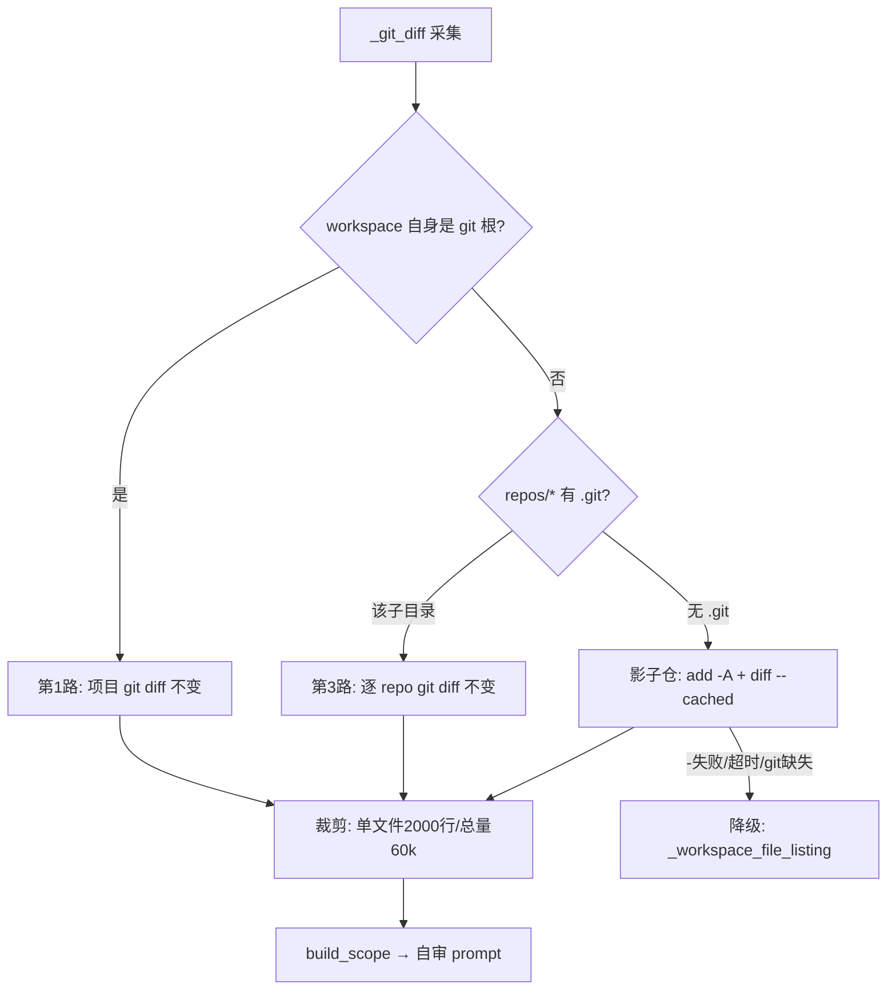

# 无 git 任务的自审改动采集：影子仓库方案

- 日期：2026-11-06
- 样本任务：`ini_b93e23b70190`「帮我写一个可运行贪吃蛇小游戏，支持用户登陆注册」
- 状态：已完成（影子仓 + diff 注入 + 工具限制三层均已落地并实测）

---

## 优化逻辑总览

整条优化围绕一个判断：**自审缺的是「改动内容」，不是「审查能力」**。三层措施依次解决
「拿不到」「塞不下」「还在读」：

| 层 | 问题 | 措施 | 收益（实测） |
|---|---|---|---|
| 1. 采集 | 无 git → 只有文件清单，`diff_lines=0` | 影子仓 `missions/<id>/.shadow.git`：baseline + `git diff --cached HEAD` | 24 文件 diff **91ms** 拿到，不再退化成 24 次 `Read` |
| 2. 投递 | 有了 diff 但 prompt 里没有正文；全量塞又会挤掉指令 | `ReviewScope.diff_excerpt` + `clip_diff`（总量 60k 字符 / 单文件 2000 行，超限降级为符号清单） | prompt ≈ 6 万字符，正文完整、审查指令不被挤掉 |
| 3. 约束 | 模型有了 diff 仍去核对文件（boundaries 轮 354.7s） | `TDT_REVIEW_DISALLOWED_TOOLS`（默认禁 `Read,Bash,Grep,Glob`）+ 规则区声明 | 单轮 **100.4s → 39.0s**，5 轮 ≈ 3-4 分钟 |

三者缺一不可：只有 1 拿得到，但 prompt 里没有正文；只有 1+2，模型仍会自己读文件；
只有 3 而没有 diff，模型无据可依。

---

## 一、问题背景

### 1.1 现象

该任务 `eng_implement` 阶段耗时 **35m28s**，其中自审占 **970s（16m11s，45.6%）**，最终 `verdict=degraded`，5 个镜头里只有 2 个真正执行，且都超时：

| # | 镜头 | 状态 | 耗时 | 说明 |
|---|---|---|---|---|
| 1 | correctness 正确性与不变量 | `failed` | 485.4s | `timeout after 480s`，reply 0 字符 |
| 2 | boundaries 空值与边界 | `failed` | 485.3s | `timeout after 480s`，reply 0 字符 |
| 3 | concurrency 并发与部分失败 | `skipped` | 0 | 熔断：第 2 轮超时，跳过剩余审查 |
| 4 | security 安全与信任边界 | `skipped` | 0 | 同上 |
| 5 | test_gaps 测试缺口 | `skipped` | 0 | 同上 |

### 1.2 现场还原

自审窗口 21:16:21–21:32:32 内只有 **16 次工具调用**，平均步间隔 **60.9s**：

| 时刻 | 间隔 | 动作 |
|---|---|---|
| 21:17:36 | 42.7s | Bash（cd + 找文件） |
| 21:20:59 | 32.2s | `cat -n snake/server.py` |
| 21:23:09 | **129.7s** | `cat -n snake/web/app.js` |
| 21:24:12 | 63.2s | `cat -n tests/test_service.py` |
| 21:26:02 | 54.6s | `Read server.py` |
| 21:29:19 | 48.9s | `Read test_constants_sync.py` |

即：模型在**逐个读文件**，480s 只够 7–8 步，而审查范围有 24 个文件，必然读不完，到点被 `asyncio.wait_for` 硬杀，`reply_chars=0`（review 块要求放回复末尾，被杀时还没写）。

### 1.3 根因链

1. 该任务工作区不是 git 仓库，`_git_diff` 退化到「文件清单」：
   ```385:385:/Library/git-root/sortie-deck-todos/src/sortie_deck/plugins/coding.py
       return f"# worktree files (no git)\n{listing}\n"
   ```
   实际产物 `diff.patch` 仅 624 字节，`complexity.signals.diff_lines = 0`。
2. `ReviewScope.render()` 只输出路径，不输出内容：
   ```274:297:/Library/git-root/sortie-deck-todos/src/sortie_deck/review_lens.py
       def render(self) -> str: ...
   ```
3. prompt 又明确要求逐个打开：
   ```596:596:/Library/git-root/sortie-deck-todos/src/sortie_deck/review_lens.py
   "- 需要看细节时用 Read 打开上面的文件路径，不要凭文件名猜内容。"
   ```
4. 前两轮镜头 `fix_allowed` 默认为 `True`（`review_lens.py:73`），模型边读边改，进一步拉长。

### 1.4 预算账

- eng 阶段上限 3600s（`settings.py:342`），首轮实现用掉 1157s，收尾预留 60s
- (3600 − 1157 − 60) ÷ 5 轮 ≈ **477s**，即实际 480s
- 两轮耗尽 970s 后熔断，阶段还剩约 24 分钟预算没用，却直接判 `degraded`

---

## 二、业界调研

调研工具：agent-reach（v1.6.1，`web`/Exa 通道）+ 官方文档直取。

| 方案 | 代表 | 机制 | 非 git 项目 |
|---|---|---|---|
| **影子仓库** | Cline、Roo Code、Gemini CLI、CodeBolt | 独立 `GIT_DIR` + `GIT_WORK_TREE`，每次改动自动 commit，与项目 `.git` 隔离 | 可用 |
| **文件快照** | Claude Code、Cursor | 按 turn 对编辑过的文件存完整快照 | 可用 |
| **引导/强制建仓** | Aider、SWE-bench | 询问建仓 / 直接 `git diff HEAD` | 需要 |
| **目录快照对比** | agent-review-roundtable `--directory` | 两次目录快照逐文件 diff | 可用 |

来源：

- Cline：https://docs.cline.bot/core-workflows/checkpoints
- Roo Code：https://docs.roocode.com/features/checkpoints（明确「不需要项目是 git 仓库，唯一前提是本机有 git」，排除规则写 `.git/info/exclude`）
- Gemini CLI：https://github.com/google-gemini/gemini-cli/blob/main/docs/cli/checkpointing.md
- Aider：https://aider.chat/docs/git.html
- Claude Code：https://docs.claude.com/en/docs/claude-code/checkpointing
- Cursor：https://cursor.com/docs/agent/chat/checkpoints
- CodeBolt：https://docs.codebolt.ai/docs/concepts/persistence/shadow-git-and-checkpoints
- SWE-bench-Live：https://github.com/microsoft/SWE-bench-Live/blob/main/evaluation/README.md

结论：主流做法不是「要求项目必须是 git 仓库」，而是**自带一个影子仓，把 git 当 diff 引擎**。

---

## 三、方案设计

### 3.1 核心思路

在 `_git_diff` 的三路来源里，把第 2 路（当前只给文件清单）升级为「影子仓 diff」：



### 3.2 覆盖范围（关键修正）

不绑 git 的任务，代码写在 `workspace/repos/<项目名>/` 下（本任务即 `repos/snake/*`）。因此：

| 情况 | 处理 |
|---|---|
| `workspace` 自身是 git 仓库根 | 第 1 路，**不建**影子仓 |
| `repos/foo` **无** `.git`（从 0 开发） | 影子仓**正常覆盖** |
| `repos/foo` **有** `.git`（绑仓 clone） | 影子仓**跳过该子目录**，交第 3 路 |
| `workspace` 顶层其他文件 | 影子仓覆盖 |

影子仓 work tree 是整个 `workspace`，排除粒度是**子目录级**，不是整个 `repos/`。

### 3.3 与绑仓任务的隔离

| 维度 | 绑仓任务 | 从 0 开发（影子仓） |
|---|---|---|
| `GIT_DIR` | 项目/`repos/<name>` 的 `.git` | `<data_dir>/missions/<id>/.shadow.git` |
| 索引/暂存区 | 项目 index | 影子仓 index |
| 提交历史 | 项目历史 | 独立历史，项目 `git log` 看不到 |
| 取 diff 路径 | 第 1 路 / 第 3 路 | 第 2 路 |
| 对 agent 可见性 | 正常 `git` 可用 | 不可见（只注入子进程 env） |

三条必须遵守的约束：

1. `GIT_DIR` / `GIT_WORK_TREE` **只通过 `_run_cmd(extra_env=...)` 注入单次子进程**，不写 `os.environ`，否则 agent 自己 `git status` 会看到影子仓。
2. 注入 `GIT_CONFIG_GLOBAL=/dev/null`、`GIT_CONFIG_SYSTEM=/dev/null`，避免用户全局 `commit.gpgsign=true` 或缺 `user.email` 导致 commit 失败。
3. 每次采集前**动态重扫** `repos/*/.git`：`.git` 可能阶段中途才出现（agent 自己 `git init`），不重扫会产生 `Subproject commit` gitlink。

### 3.4 基线时机

baseline 必须在 **agent 首轮编辑之前**（clone 完成后）。若在阶段末才建，diff 为空。

### 3.5 裁剪策略

- 裁剪**只作用于 prompt**，`diff.patch` 产物保持完整（下游 QA 依赖）。
- 单文件上限 2000 行、总量上限 60000 字符；超限文件降级为「文件头 + 省略行数 + `def`/`class`/`function` 符号清单」。
- 参数可配：`TDT_REVIEW_DIFF_MAX_CHARS`、`TDT_REVIEW_DIFF_MAX_FILE_LINES`。

### 3.6 prompt 调整

`review_lens.py:596` 改为：

> 改动已在审查范围内给出，**默认不要再逐个 Read 文件**；仅在需要调用链上下文时读取，最多 3 次。

### 3.7 自审轮的工具限制

只靠 prompt 约束不够：实测同一镜头仍读了 25 个文件。`TDT_REVIEW_DISALLOWED_TOOLS`
（默认 `Read,Bash,Grep,Glob`）在 `_run_review` 里并入阶段 pack 的 `disallowed_tools`，
由 harness 映射到 SDK 的禁用列表；同时由 `build_lens_prompt(disallowed=...)`
写进**规则区**。

不能追加到 prompt 末尾：会盖掉最后的 `review` 输出协议，实测出现 `status=unparsed`
（41.7s，回复 2818 字符但没有 review 块）。

保留 `Edit/Write`，correctness / boundaries 仍可就地修；留空 = 不禁用（回滚）。

---

## 四、落地清单

| 文件 | 改动 |
|---|---|
| `src/sortie_deck/shadow_git.py` | **新增**：`ShadowRepo`（`ensure` / `capture` / `reset`）+ `ensure_shadow_baseline`；独立 `GIT_DIR`、动态 pathspec 排除嵌套仓库、baseline、diff 采集，异常内部降级 |
| `src/sortie_deck/plugins/coding.py` | `_git_diff` 第 2 路接影子仓（路径从 `workspace.parent` 推导，无需新参数）；`clone_repos` 两个返回分支前打 baseline |
| `src/sortie_deck/review_lens.py` | `ReviewScope.diff_excerpt`、`clip_diff()`、`build_lens_prompt(disallowed=...)`、`run_review_lenses(disallowed_tools=...)` |
| `src/sortie_deck/harness_providers/executor.py` | prompt 用裁剪版 diff（`diff.patch` 产物保持完整）；`_review_disallowed_tools` / `_merge_disallowed`，自审 `send` 使用 review_pack |
| `src/sortie_deck/settings.py` | 新增 5 个配置项：`shadow_git_enabled`、`shadow_git_max_file_bytes`、`review_diff_max_chars`、`review_diff_max_file_lines`、`review_disallowed_tools` |
| `tests/test_shadow_git.py` | **新增**：9 条用例（含多阶段重新基线） |
| `tests/test_review_lens.py` | 补 `clip_diff` 4 条 + 工具限制 2 条 |
| `docs/自审分档与代码审查策略.md` | 新增「无 git 项目的改动采集：影子仓」附录 + 2.3 改动面来源 + 工具限制 |
| `CHANGELOG.md` | `[Unreleased]` 记录（影子仓、diff 预算、工具限制） |

### 4.1 接口

```python
class ShadowRepo:
    # 影子仓固定落在 workspace.parent/.shadow.git，不进 workspace
    def __init__(self, workspace: Path, *, timeout: float = 60.0) -> None: ...

    async def ensure(self) -> bool:
        """创建或重新基线（每阶段一次）；workspace 自己是 git 根时返回 False。"""

    async def capture(self) -> str | None:
        """add + diff --cached HEAD；None = 不可用（调用方回退文件清单）。"""

    async def reset(self) -> None:
        """删除影子仓目录。"""
```

---

## 五、验证方式

1. `ruff check src tests` + `pytest -q` 全绿
2. 用本任务历史结构构造 fixture（24 文件、`repos/` 无 `.git`）→ 断言 diff 含 `+` 行、`diff_lines > 0`、`workspace` 下不出现 `.git`
3. 绑仓回归：`tests/test_stage_boundary.py:190-290`、`tests/test_role_repos.py:94-99` 的 diff 输出与改动前一致
4. 人工检查 `build_scope().render()` 输出「改动文件 24 个（+N/-0 行）」而非「无 git 差异，按现存文件推断」

预期收益：24 文件场景从 24+ 步 / 16 分钟，降到 1 次 diff + 1–2 步补充，单阶段自审目标 3–5 分钟。

---

## 六、端到端实测（2026-11-06）

按真实任务 `ini_b93e23b70190` 的 24 文件结构（`repos/snake/*.py`、`web/*`、`tests/*`、
`tests_js/*`、`run.sh`、`scripts/smoke.py`、`checklist.md`）构造 fixture，经
`coding._git_diff` 真实链路跑两阶段：

| 场景 | 结果 |
|---|---|
| 阶段 1 `ensure()`（baseline） | 166 ms |
| 阶段 1 `_git_diff()` | **91 ms**，24 文件 / 2941 行 / 59718 字符 |
| 阶段 1 兜底清单是否出现 | 否（`# worktree files (no git)` 未出现） |
| `workspace/.git` | 不存在（影子仓在 `<mission>/.shadow.git`） |
| 阶段 2 `ensure()`（重新基线） | 176 ms，返回 True |
| 阶段 2 `_git_diff()`（只改 2 文件） | **69 ms**，2 文件 / 22 行 / 560 字符 |

对比原链路：同一阶段自审 970s、16 次 `Read`、两轮 480s 超时。

### 多镜头自审实测（真实 `claude` CLI 2.1.317）

| 配置 | 单轮（correctness） | 5 轮串行 |
|---|---|---|
| 改动前（无 diff，逐个 Read） | 135.6s | 970s：2 轮超时 + 3 轮熔断，`degraded`，**0 条结论** |
| 影子仓 + diff 注入，允许 Read | 100.4s | **633.5s ≈ 10.6 分钟**，5 轮全成功，32 条 findings |
| 再叠加工具限制（禁 Read/Bash/Grep/Glob） | **39.0s** | 推算 **≈ 3-4 分钟**，8 条 findings，结论仍 blocking |

其中 `boundaries` 单轮 354.7s，回复里明确写「实际核对了 workspace 的真实内容」——即使
prompt 里已给出完整 diff，模型仍会逐文件读，这是加工具限制的直接依据。

### 实测发现的 bug 与修复

首次实测「阶段 2 期望 2 文件、实际 24 文件」：影子仓建好后，`_workspace_is_git_root()`
在注入 `GIT_DIR` 的环境下跑 `git rev-parse --show-toplevel`，结果返回 workspace 自身
（`rc=0`），于是 `ensure()` 判定「项目自己是 git 仓库」直接返回 False，baseline 不前移。

修复：探测项目仓库时使用剔除 `GIT_*` 的干净环境（正确结果 `rc=128`），并补
`test_shadow_rebaselines_on_next_stage` 锁定该行为。

## 七、风险与回滚

| 风险 | 处置 |
|---|---|
| 大 workspace 首次 `git add -A` 慢 | 静态 exclude（依赖/缓存/二进制）+ 单文件大小上限 + 60s 超时降级 |
| agent 阶段内 `git init` | 每次采集前重扫 `.git` 并写入 exclude |
| `repos/.gitignore` 误排除测试文件 | diff 采集后校验 manifest 声明文件，缺失则记 warning 并在 scope 标注 |
| 影子仓占磁盘 | 随 mission 目录清理；`reset()` 可手动删 |

**回滚开关**（均无需改代码）：

- `TDT_SHADOW_GIT_ENABLED=false`：回到文件清单逻辑
- `TDT_REVIEW_DISALLOWED_TOOLS=`（留空）：恢复自审轮可用全部工具
- `TDT_REVIEW_DIFF_MAX_CHARS` / `TDT_REVIEW_DIFF_MAX_FILE_LINES` 调大：保留更多 diff 正文
