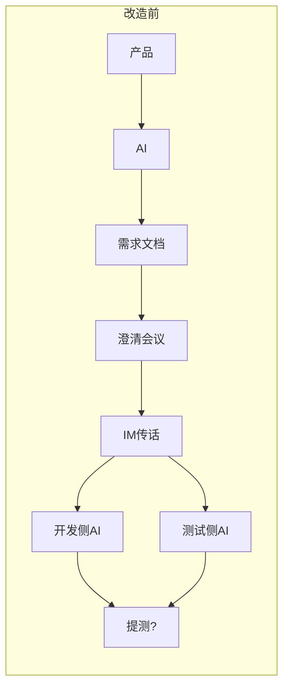
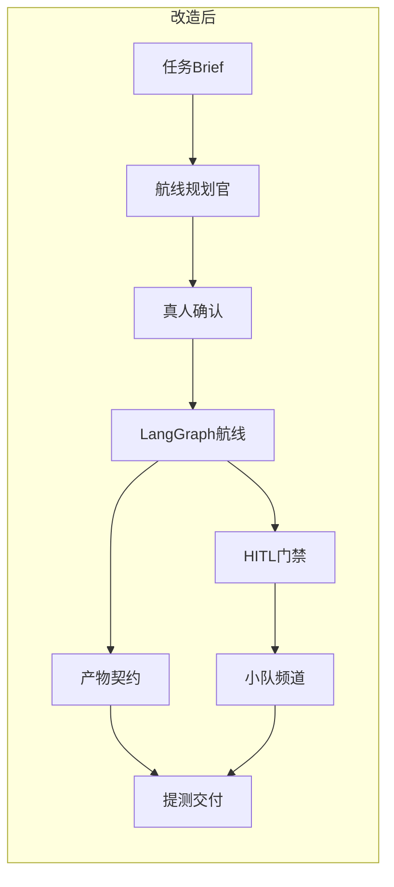

# 改造方案介绍

Sortie Deck 的创作思想很简单：**办公迭代不该靠人当传话筒**。  
AI 已经进场，但如果仍用 IM 工具当总线、每人各开一个聊天窗口，真相源会碎成多份粘贴。

本文用两张手绘图对照 **改造前** 与 **改造后**。

## 改造前：传话筒式 AI 协作

典型路径看起来「也用了 AI」，但总线仍是人和 IM：

1. **产品** → 打开 AI → 生成 **需求文档**
2. 拉起 **澄清沟通会议**（纪要再经 IM 转发）
3. 分叉后，**开发 / 测试各自** 再把需求文档丢给自己的 AI
4. 联调、评审、提测之间继续用 **IM 工具传话**、截图当契约

痛点：无统一航线、无产物契约、门禁=群里 @ 一下、版本对不上。

### 改造前一句话

> 产品 → AI → 需求文档 → 澄清会议 → IM 传话 → 开发/测试各自的 AI → 提测？

## 改造后：Sortie Deck 控制面

把「聊天接力」换成 **可确认航线 + 契约产物 + 人在环门禁**：

| 改造前 | 改造后 |
|--------|--------|
| IM 工具当总线 | 小队频道可见协作；IM 不再当真相源 |
| 每人各开 AI 窗口 | 任务级角色 Agent + 可插拔执行器 |
| 粘贴 / 截图当契约 | 命名产物文件，下游读文件不读聊天 |
| 会议纪要再转发 | Brief → 航线规划官提案 → **真人确认** 后出击 |
| 群里 @ 当门禁 | LangGraph `interrupt()` HITL（放行 / 改写 / 打回） |

### 改造后一句话

> Brief → 可确认航线 → 角色 Agent 按契约交付 → HITL 门禁 → 小队可见协作 → 提测 / 交付

## 对照骨架（文字）

## 落地抓手（本仓库已有）

- 航线：提案 → 确认 → 编译图（见 [航线规划](../modules/pipeline.md)）
- 图与门禁：[图·门禁·契约](../modules/graph.md)
- 小队：[小队频道](../modules/rooms.md)
- 产物：[产物与存储](../modules/artifacts.md)
- 架构总览：[overview](../architecture/overview.md)

## 改造原则（不变）

1. **控制面，不是又一个聊天框**
2. **契约化产物** — 下游读文件
3. **人在环** — 关键阶段可暂停、可恢复、可审计
4. **可确认航线** — 出击前真人拍板
5. **可组合编制** — 角色 / 工具包 / 记忆按任务挂载
