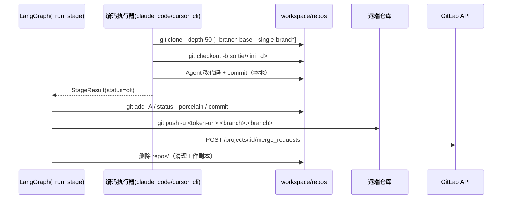

# Git 回写链路解析：编码阶段 → 任务分支 → MR

> 本文按源码逐步拆解「阶段成功后走 git 回写」这件事：分支从哪来、改到哪去、MR 怎么建、失败怎么降级，以及链路里已经踩过的坑。
> 涉及代码：`src/sortie_deck/git_publish.py`、`src/sortie_deck/plugins/coding.py`、`src/sortie_deck/graph.py`、`src/sortie_deck/gitlab.py`。

## 1. 一句话定位

编码阶段结束后，把 Agent 在本地沙盒 `workspace/repos/<repo>` 里的改动，`commit` → `push` 到任务分支 `sortie/<initiative_id>` → 创建 GitLab MR（目标为仓库 base 分支）→ 删除本地副本。

它**不产出阶段产物**（那是 `artifacts/` 的事）。阶段产物里的 `diff.patch` 只是给人看的 diff 快照（`plugins/coding.py:263`、`:582`），真正的代码落库完全依赖回写链路。

## 2. 全景时序



关键点：**分支在远端出现，只可能是 `git push` 那一刻**，`checkout -b` 不触达远端。

## 3. 前置：克隆与任务分支

### 3.1 克隆

入口 `clone_repos()`（`plugins/coding.py:307`），编码执行器启动前调用：

```text
git clone --depth 50 [--branch <repo.branch> --single-branch] <带 token 的 https url> workspace/repos/<name>
git remote set-url origin <无 token 的 url>      # 避免凭证落盘 .git/config
```

| 细节 | 说明 |
|---|---|
| 目录名 | `RepoConfig.name` 优先；否则取 url 末段并去掉 `.git`（`coding.py:290-297`） |
| 深度 | `--depth 50` 浅克隆 |
| 分支限定 | 配了 `repo.branch` 才加 `--branch ... --single-branch`，此时本地只有这一个分支 |
| token | 只出现在命令行 URL 里（`coding.py:300-304`），日志会脱敏 |
| 磁盘保护 | 可用空间低于 `TDT_MIN_DISK_FREE_MB`（默认 2048MB）直接跳过 clone 并告知 Agent（`coding.py:330-349`） |
| 幂等 | `workspace/repos/<name>` 已存在 `.git` 就复用，不重复克隆（`coding.py:356-357`） |

### 3.2 任务分支

克隆完成后（`coding.py:373-389`）：

```text
git rev-parse --verify <task_branch>
  ├─ 成功 → git checkout <task_branch>        # 本地已有，复用
  └─ 失败 → git checkout -b <task_branch>     # 从当前 HEAD（= 刚检出的 base 分支）新建
```

- `--branch` 本身**不建新分支**，它只是检出既有远端分支，本地分支名与远端同名；
- 新建的任务分支基于「当前检出分支此刻的 HEAD」，即 `repo.branch`（未配则是默认分支）的克隆时点提交；
- 只有 `git checkout -b` 是本地动作，远端不会有任何分支。

### 3.3 分支命名

`mission_branch()`（`git_publish.py:48-53`）：

| 场景 | 分支名 |
|---|---|
| 单仓库 | `sortie/<initiative_id>` |
| 多仓库 | `sortie/<initiative_id>-<repo_name>` |

- 前缀由 `TDT_GIT_BRANCH_PREFIX` 控制（默认 `sortie`，`settings.py:254`）；
- 非法字符统一替换为 `-`，最长 80 字符（`git_publish.py:44-45`）；
- 名称是确定性的，所以同一任务的多个编码阶段会累积提交到**同一条分支**，最终每仓库只有一个 MR。

## 4. 触发条件

调用点 `graph.py:1686`（写在产物落盘、契约校验之后），判定在 `_maybe_publish()`（`graph.py:58-80`），需同时满足：

| 条件 | 说明 |
|---|---|
| `TDT_GIT_PUSH_MODE != off` | 默认 `on_stage_success`（`settings.py:257`） |
| `StageResult.status == "ok"` | 失败/超时的阶段不回写 |
| `ctx.repos` 非空 | 该角色必须绑定了 mission repos |
| `ctx.workspace_dir` 存在 | 沙盒目录必须可用 |
| `publish_pending`（仅 `on_approval` 模式） | 只有 HITL 权限放行重入时才置位（`graph.py:2066`） |

## 5. 回写五步

入口 `publish_repos()`（`git_publish.py:171-232`），**逐仓库串行**，单仓库失败不影响其余仓库。

### 5.0 流程速览

```text
workspace/repos/<name>
  ├─ 1. 校验 .git 存在（git_publish.py:193）——不在就记 error「checkout 缺失」并跳过
  ├─ 2. git add -A + git status --porcelain（git_publish.py:99-106）——无变更就不 commit（幂等）
  ├─ 3. git -c user.name="Sortie Deck" -c user.email=sortie-deck@localhost commit -m "sortie: <ini> stage=<stage>"（git_publish.py:108-119）
  ├─ 4. git push -u <带 token 的完整 URL> <branch>:<branch>（git_publish.py:130）
  │      再 update-ref refs/remotes/origin/<branch> HEAD（git_publish.py:135，供脏状态判定）
  ├─ 5. GitLab API 建 MR（git_publish.py:139-168）——标题 "Sortie Deck: <ini> → <base>"，
  │      描述写「自动创建，请人工审核合并」；未配 TDT_GITLAB_BASE_URL / token → 跳过，只 push 不建 MR
  └─ 6. 全部仓库无 error 且 TDT_GIT_CLEANUP_AFTER_PUSH=true（默认，settings.py:264）
         → cleanup_repos 删除 workspace/repos（git_publish.py:230-250）
```

下面按步骤展开。

### 5.1 commit（`git_publish.py:97-122`）

```text
git add -A
git status --porcelain              # 无变更 → 不提交，直接跳过
git -c user.name="Sortie Deck" -c user.email=sortie-deck@localhost commit -m "sortie: <ini_id> stage=<stage>"
```

- 无变更不 commit（幂等，QA 打回重跑不会产生空提交）；
- 用 `-c` 注入提交身份，不依赖服务器全局 git 配置；
- commit message 截断 500 字符。

### 5.2 push（`git_publish.py:125-136`）

```text
git push -u <带 token 的完整 URL> <branch>:<branch>
git update-ref refs/remotes/origin/<branch> HEAD
```

- refspec `branch:branch` 才是「在远端创建分支」的动作；
- 用完整 URL push，token 不写进 remote 配置；失败信息会做 token 脱敏；
- push 后手动同步 `refs/remotes/origin/<branch>`，供 `is_dirty()` 判定「已上库/未上库」。

### 5.3 MR（`git_publish.py:139-168` → `gitlab.py:112-142`）

| 项 | 值 |
|---|---|
| source_branch | 任务分支 `sortie/<ini_id>[-repo]` |
| target_branch | `repo.branch`；为空则不传，由 GitLab 用项目默认分支 |
| title | `Sortie Deck: <ini_id> → <base>` |
| description | 明确写「自动创建，请人工审核合并」 |
| 幂等 | 先 `find_open_mr(source_branch)`，已有 open MR 直接复用 `web_url` |
| 凭证 | 优先 `TDT_GITLAB_API_TOKEN`，否则回退 `RepoConfig.token` |
| 前置 | 未配 `TDT_GITLAB_BASE_URL` 直接跳过，只 push 不建 MR |

MR 只是「任务分支 → base 分支」的合并请求，**不会自动合并**：`GitLabClient` 只有 `find_open_mr` / `create_mr` 两个方法，没有 merge API。

### 5.4 清理（`git_publish.py:230-250`）

只在「所有仓库都无 error」且 `TDT_GIT_CLEANUP_AFTER_PUSH=true`（默认）时执行：删除 `workspace/repos`，保留沙盒目录本身。

设计意图：分支权威数据在 GitLab，本地 clone 只是缓存；QA 打回重入时重新浅克隆即可。

### 5.5 结果聚合

`publish_summary_meta()`（`git_publish.py:338-345`）把结果整理成：

```json
{
  "git_publish": [{"repo_name": "...", "branch": "sortie/ini_x", "committed": true,
                   "pushed": true, "mr_url": "https://gitlab/.../merge_requests/1", "error": null}],
  "git_publish_pushed": 1,
  "git_publish_errors": []
}
```

合并进 `StageResult.meta`（`graph.py:1686-1688`），随后随阶段事件推到工作台时间线。

## 6. 失败与降级语义

| 场景 | 行为 |
|---|---|
| 单仓库 checkout 缺失（`repos/<name>` 无 `.git`） | 该仓库记 `error="checkout 缺失"`，继续下一个（`git_publish.py:193-204`） |
| `git add` / `commit` / `push` 失败 | 记 `error` 字符串，继续下一个仓库 |
| MR 创建失败（400/401/分支不存在等） | 只记 warning，`mr_url=None`，**不回滚 push**（`git_publish.py:165-168`） |
| 回写整体异常 | `_maybe_publish` 外层 `except Exception` 兜底，只返回 `git_publish_errors`，阶段结果不受影响（`graph.py:76-79`） |
| 清理失败 | 捕获 `OSError` 与 `SystemExit`，只记 warning（`git_publish.py:243-250`），见 7.1 |

设计原则：回写是「附加动作」，不能反过来改变阶段成败判定。

## 7. 已知问题与修复进展

### 7.1 清理动作的异常类型覆盖不足（2026-10-27 事故，已修复）

`cleanup_repos()` 用 `asyncio.to_thread(shutil.rmtree, repos_root)`（`git_publish.py:241`），原先只捕获 `OSError`（`:243`）。

实际事故：任务 `ini_45e90a2a236a` 的 `eng_backend_tech_design` 阶段成功后，删除 `workspace/repos`（6751 个文件）被运行环境的安全删除组件接管，直接 `raise SystemExit(1)`：

- `except OSError` 拦不住（`SystemExit` 继承 `BaseException`）；
- `_maybe_publish` 的 `except Exception`（`graph.py:77`）也拦不住；
- `_run_until_interrupt_inner` 的 `except Exception`（`orchestrator.py:1956`）同样拦不住。

结果：异常穿过 LangGraph 与 ASGI，运行任务和 API 进程一起退出，任务状态既没落 `failed` 也没落 `completed`，停在 `running`；而 `start_pipeline` 对 `RUNNING` 直接返回（`orchestrator.py:1300-1302`），从 UI 点「启动」无任何反应，表现为「卡死」。

**修复（2026-10-28）**：

| 位置 | 改动 |
|---|---|
| `git_publish.py:243-250` | `cleanup_repos` 改为 `except asyncio.CancelledError: raise` + `except (OSError, SystemExit)`，清理失败只记 warning |
| `git_publish.py:260-262` | `cleanup_workspace` 同样覆盖 `SystemExit`（终态 / TTL 清理路径） |
| `orchestrator.py:1956-1989` | 先 `except asyncio.CancelledError: raise`，再 `except BaseException`：非 `Exception` 的退出信号也会先落 `failed` + 时间线 error 事件；`SystemExit` 不再上抛（改为正常返回），其余异常（如 `KeyboardInterrupt`）仍原样上抛 |

**仍未处理**：

- inline 后端重启后遗留的无主 `running` 任务不会自动回收，仍需手动置 `failed` 或提供 reset 接口；
- 清理失败后 `repos/` 会留在磁盘，依赖 TTL sweep 兜底（见 7.3）。

### 7.2 单分支浅克隆与重入分叉

clone 带 `--single-branch` 时本地只有 base 分支，看不到远端已有的任务分支。若 `workspace/repos` 已被清理（回写成功后的正常路径），QA 打回重入编码阶段会：

1. 重新浅克隆 base 分支；
2. `git rev-parse --verify sortie/<id>` 失败 → `checkout -b` 从 base HEAD 重新拉一条历史；
3. 提交后 `git push`（普通 push，无 `--force-with-lease`）因非快进被远端拒绝。

改进方向：clone 后先 `git fetch origin <task_branch>`，本地存在则直接 checkout 复用历史，避免分叉。

### 7.3 清理失败会残留磁盘

清理失败只记 warning，`repos/` 会留下（本次事故后仍有 6733 个文件）。虽然有 TTL 兜底扫描 `sweep_worktrees()`（`git_publish.py:297`），但它会跳过 `running` / `waiting_hitl` 的任务（`orchestrator._active_mission_ids`），僵尸 `running` 任务永远不会被回收。

## 8. 配置项

| 环境变量 | 默认 | 作用 |
|---|---|---|
| `TDT_GIT_PUSH_MODE` | `on_stage_success` | `on_stage_success` / `on_approval` / `off` |
| `TDT_GIT_BRANCH_PREFIX` | `sortie` | 任务分支前缀 |
| `TDT_GITLAB_BASE_URL` | 空 | GitLab 地址，空则不建 MR |
| `TDT_GITLAB_API_TOKEN` | 空 | 建 MR 用；空则回退各仓库自身的 token |
| `TDT_GIT_CLEANUP_AFTER_PUSH` | `true` | push 全部成功后删除 `workspace/repos` |
| `TDT_WORKTREE_TTL_SECONDS` | `86400` | 非活跃任务 workspace 保留时长 |
| `TDT_WORKTREE_DIRTY_TTL_SECONDS` | `604800` | 有未提交/未推送改动时的延长保留 |
| `TDT_MIN_DISK_FREE_MB` | `2048` | clone 前磁盘水位，低于则跳过克隆 |

## 9. 代码索引

| 能力 | 位置 |
|---|---|
| 回写触发判定 | `graph.py:58-80`，调用点 `graph.py:1686` |
| MR 触发条件 `publish_pending` | `graph.py:2066` |
| 克隆与任务分支 | `plugins/coding.py:307-405`（分支逻辑 `:373-389`） |
| 分支命名 | `git_publish.py:48-53` |
| commit | `git_publish.py:97-122` |
| push | `git_publish.py:125-136` |
| MR 创建 | `git_publish.py:139-168`、`gitlab.py:112-142` |
| 清理工作副本 | `git_publish.py:235-250` |
| 脏状态判定 / TTL 扫描 | `git_publish.py:258-335` |
| 结果聚合 | `git_publish.py:338-345` |
| 阶段状态落库与异常兜底 | `orchestrator.py:1864-1989` |
