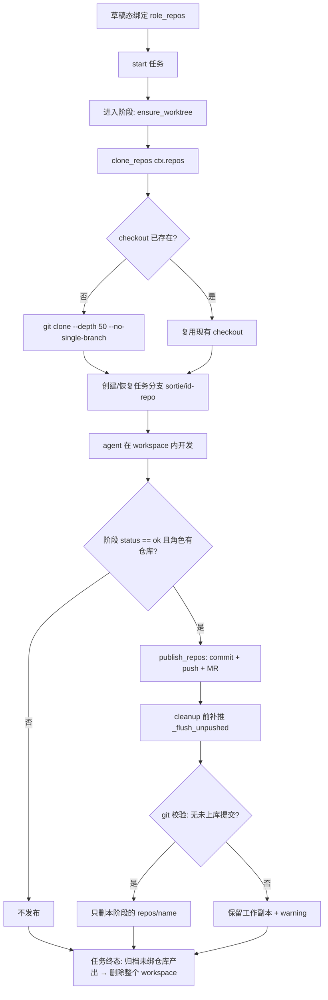

# 多端开发 Agent：仓库克隆、任务分支与回写机制

> 说明：本文描述「一个任务里同时有前端 / Android / iOS / 服务端等多个开发角色，每个角色绑定自己的 git 仓库」时，
> 代码实际怎么拉取、落在哪、怎么回写远程、什么时候清理。
>
> 对应实现：`src/sortie_deck/plugins/coding.py`、`src/sortie_deck/git_publish.py`、
> `src/sortie_deck/harness_providers/executor.py`、`src/sortie_deck/graph.py`。
> 最近更新：2026-11-05（任务分支复用、cleanup 前补推与校验）。

---

## 1. 一句话概览

**一个任务 = 一个沙盒目录；每个阶段只准备「本阶段角色」绑定的仓库；代码落在 `workspace/repos/<仓库名>`；
编码阶段成功后 commit + push 到任务分支并建 MR，确认没有未上库提交后才删除工作副本。**

---

## 2. 数据模型

### 2.1 仓库配置

```python
# src/sortie_deck/models.py
class RepoConfig(BaseModel):
    url: str
    branch: str = ""                                  # 基线分支；空 = 远端默认分支
    name: str = ""                                    # checkout 目录名；空 = URL basename
    source: Literal["workspace", "custom"] = "custom" # 凭据来源
    credential_id: str | None = None
    token: str | None = None                          # 已废弃，仅兼容历史数据
```

| 字段 | 作用 | 备注 |
|---|---|---|
| `url` | clone 地址 | 只存裸 URL；凭据不拼进 URL |
| `branch` | 任务分支的基线 | 任务分支 `sortie/<id>-<repo>` 从它创建 |
| `name` | `workspace/repos/` 下的目录名 | 同名仓库共享同一个 checkout |
| `source` | 凭据来源 | `workspace`=管理员工作区凭据；`custom`=任务创建者个人凭据 |

### 2.2 仓库挂在「角色」上

```json
{
  "meta": {
    "role_repos": {
      "eng_web":     [{"url": "https://git.example.com/team/web.git", "name": "web"}],
      "eng_android": [{"url": "https://git.example.com/team/app-android.git"}],
      "eng_ios":     [{"url": "https://git.example.com/team/app-ios.git"}],
      "eng_backend": [{"url": "https://git.example.com/team/api-server.git"}]
    }
  }
}
```

- 存储位置：`ini.meta["role_repos"]`，同时冗余在 `roles[].repos`；
- 绑定时机：**仅草稿态**，接口 `PATCH /api/initiatives/{id}/repos`；启动后返回 409；
- 绑定时会先做凭据/连通性预检（`preflight_role_repos`），避免拖到编码阶段才报错。

### 2.3 每个阶段只取自己的那份

```python
# src/sortie_deck/graph.py（构造 StageContext）
repos=[RepoConfig.model_validate(r) for r in (role_repos_state.get(role.value) or [])]
```

- `eng_web` 阶段 → 只拿到前端仓库；
- `eng_backend` 阶段 → 只拿到服务端仓库；
- 产品 / 设计 / QA 等角色通常没有仓库，`ctx.repos` 为空。

---

## 3. 生命周期总览



关键点：

1. 克隆发生在**每个阶段进入时**，不是任务启动时一次性；
2. 克隆是幂等的：`.git` 存在就复用；
3. 任务级沙盒只有一个，所有角色/阶段共用；
4. 清理以「确认已上库」为前置条件。

---

## 4. 目录布局

```
data/missions/<initiative_id>/
├── workspace/                      # 任务级沙盒，所有阶段/角色共用
│   ├── .upstream/                  # 编码阶段：上游产物只读镜像
│   ├── .archive/                   # 跨阶段遗留契约文件归档
│   ├── README.md                   # 沙盒说明
│   └── repos/
│       ├── web/                    # 前端
│       ├── app-android/            # Android
│       ├── app-ios/                # iOS
│       └── api-server/             # 服务端
├── artifacts/<stage>/              # 阶段产物（prd.md / diff.patch / …）
├── memory/                         # 任务记忆
└── chat/                           # 房间与航线状态
```

规则：

- `workspace` 路径只由 `initiative_id` 决定（`ensure_worktree`），**不带角色/阶段层级**；
- `repos/<name>` 是一级目录，系统不会按角色、阶段、分支再嵌套；
- 不同角色的仓库只要 `name` 不同就各占一个目录；同名共享同一个 checkout；
- 每个任务独立一份，不跨任务缓存/共享。

---

## 5. 阶段内的准备流程（clone_repos）

入口：

```python
# src/sortie_deck/harness_providers/executor.py
workspace = ensure_worktree(data_dir.parent, ctx.initiative_id, worktrees_dir)
repo_section, repo_log = await clone_repos(
    ctx.repos, workspace, ctx.initiative_id, actor_user_id=ctx.actor_user_id
)
```

### 5.1 步骤

1. **未绑定仓库**：只创建 `workspace/repos/`，作为约定产出目录（终态会打包归档）；
2. **磁盘水位防护**：可用空间 < `min_disk_free_mb`（默认 2048MB）时跳过克隆，并在 prompt 中告知 agent「本轮无仓库可用」；
3. **凭据解析**：
   - `source=workspace` → 工作区凭据；
   - `source=custom` → 任务创建者个人凭据（按 host 匹配）；
   - HTTPS 通过 `GIT_ASKPASS` 环境变量注入，命令行与 `.git/config` 都不落密钥；
   - SSH 依赖 worker 容器内已挂载的密钥（二期能力）。
4. **克隆**：

   ```bash
   git clone --depth 50 --no-single-branch [--branch <基线分支>] <url> workspace/repos/<name>
   ```

   - `--no-single-branch` 必须显式给：`--depth` 默认隐含 `--single-branch`，只拉基线分支；
     工作副本在 push 后会被回收，重新 clone 时若看不到任务分支，会从基线重建同名分支并与远端分叉；
5. **清理远端地址**：`git remote set-url origin <裸 URL>`，避免凭据写入 `.git/config`；
6. **任务分支**（见第 6 节）；
7. **并发保护**：按 checkout 绝对路径加进程内 `asyncio.Lock`，并行阶段同时准备同名仓库时后到者复用，不会重复 clone。

### 5.2 产出

`clone_repos` 返回两段内容：

- `repo_section`：注入 prompt 的仓库清单（路径 + 基线分支 + 当前任务分支）；
- `repo_log`：写进阶段 reply / meta，用于排障（`reuse existing checkout`、`clone exit=0` 等）。

---

## 6. 任务分支策略

### 6.1 命名

```python
# src/sortie_deck/git_publish.py
def mission_branch(initiative_id, repo_name, *, multi_repo=True) -> str:
    prefix = settings.git_branch_prefix or "sortie"
    return f"{prefix}/{sanitize(initiative_id)}-{sanitize(repo_name)}"
```

示例：`sortie/ini_1f447c262543-web`

### 6.2 复用顺序

```text
refs/heads/<task_branch>              → 本地已有，直接 checkout
refs/remotes/origin/<task_branch>     → 远端已有，checkout -b 并跟踪
都不存在                               → 从当前基线 HEAD 新建
```

> 不能直接用 `git rev-parse --verify <name>` 判断：它不解析 `refs/remotes/*`，
> 会把上一阶段已 push 的任务分支误判为不存在。

### 6.3 agent 的工作约定

- 提示词明确「你正在任务分支上工作，可以自由 commit」；
- 系统发布时还会做一次兜底（见 7.2），确保 agent 自己 commit 的内容也不会丢。

---

## 7. 回写与清理

### 7.1 发布触发

```python
# src/sortie_deck/graph.py
mode = settings.git_push_mode   # off | on_stage_success（默认）| on_approval
if mode == "off" or not ctx.repos or result.status != "ok":
    return None
```

每个编码阶段成功后：

1. `git add -A` + commit（有未提交变更才提交）；
2. 检测「本地领先远端」的提交数（`rev-list --count HEAD --not --remotes`）；
3. 有提交就 push：`git push -u <url> <branch>:<branch>`，**不加 `--force`**；
4. 若配置了 GitLab，按源分支去重创建 MR（人工合并）。

结果写入 `result.meta`：

```json
{
  "git_publish": [
    {"repo_name": "web", "branch": "sortie/ini_x-web", "committed": true,
     "pushed": true, "ahead": true, "mr_url": "https://gitlab/.../merge_requests/1", "error": null}
  ],
  "git_publish_pushed": 1,
  "git_publish_errors": []
}
```

### 7.2 cleanup 前的两道闸

`settings.git_cleanup_after_push` 默认开启。删除工作副本前：

1. **补推**：对每个 checkout 再执行一次 commit + push，覆盖
   - 首轮 push 瞬时失败；
   - 并行阶段在本阶段 push 之后又写入的新提交。
2. **git 事实校验**：

   ```bash
   git rev-list --count HEAD --not --remotes   # 必须为 0
   ```

   任一仓库仍 >0 或命令失败 → **保留工作副本**并记 warning，绝不清理。
3. **按范围删除**：只删本次发布的 `repos/<name>`，不 `rmtree` 整个 `repos/`，
   避免误删并行阶段正在使用的其他 checkout；全部删空后才回收空目录。

### 7.3 任务终态

`orchestrator._cleanup_mission_workspace`：

- 未绑定仓库的任务：先把 `workspace/repos/` 打包到 `artifacts/code-archive/*.zip`，再删 workspace；
- 绑定仓库的任务：代码已在远端任务分支，跳过归档；
- artifacts / memory / chat 保留，属于任务档案。

### 7.4 TTL 兜底

`git_publish.sweep_worktrees` 在服务启动时扫描：

- 运行中的任务跳过；
- 脏工作副本（未提交/未推送）用更长的 TTL；
- 回收前同样对未绑仓库任务做归档。

---

## 8. 并行波次（eng_web ∥ eng_backend）

多端开发常见的并行形态：

```yaml
eng_planning:
  - eng_web_tech_design      (role: eng_web)
  - eng_backend_tech_design  (role: eng_backend)
eng_delivery:
  - eng_web                  (role: eng_web)
  - eng_backend              (role: eng_backend)
```

运行特征：

| 项 | 行为 |
|---|---|
| 工作目录 | 两个阶段共用同一个 `workspace` |
| 仓库准备 | 各克隆各自角色的仓库；`name` 不同互不影响 |
| 同名仓库 | 克隆阶段按路径串行（`asyncio.Lock`），不会重复 clone |
| 清理 | 只删本阶段发布的仓库目录，不碰另一个阶段的 checkout |
| 风险 | 两个阶段若绑定**同一个仓库**，clone 后是同一个 checkout，后续写入会互相影响（当前未做行级隔离） |

并行状态写入任务 meta：`meta.active_parallel = ["eng_web", "eng_backend"]`，前端据此展示多行进度。

---

## 9. 未绑定仓库的模式

- `clone_repos` 只创建 `workspace/repos/`；
- prompt 明确要求「所有代码、脚本、静态资源必须写进 `repos/`」；
- `_git_diff` 在无 git 时生成文件清单，作为 `diff.patch` 的降级内容；
- 任务终态把 `repos/` 打包成 `artifacts/code-archive/code-archive-<ts>.zip`；
- agent 若把文件写在沙盒根，归档会兜底打包根目录散落文件。

---

## 10. 已知限制与注意事项

1. **浅克隆**：`--depth 50`，历史只有最近 50 条；`git blame` / `merge-base` 等跨历史操作可能失真，需要时手动 `git fetch --unshallow`。
2. **不主动同步远端**：阶段内复用现有 checkout，不会 `git pull`；远端在任务运行期间的新提交不会自动进入工作副本。
3. **每个任务一份副本**：N 个任务 × 仓库大小，磁盘随任务数增长；靠磁盘水位与 TTL 清理兜底。
4. **`repo.name` 未清洗**：若带 `/` 会生成多级目录，带 `..` 可越出 `repos/`；建议后续用与分支名相同的 `_sanitize` 规则处理。
5. **同一仓库绑给两个角色**：并行时会共用同一个 checkout，写入互相可见；需要强隔离时应按角色拆目录或禁止重复绑定。
6. **push 不带 force**：远端任务分支若被外部改写，push 会失败并保留工作副本（不会覆盖远端历史）。

---

## 11. 排障手册

### 11.1 先看阶段 meta

```json
{
  "git_publish": [...],
  "git_publish_errors": [...],
  "git_publish_pushed": 1,
  "stale_moved": [...]
}
```

- `git_publish[].error`：该仓库失败原因；
- `git_publish[].ahead`：发布时是否存在本地领先远端的提交；
- `git_publish[].pushed=false` 且 `error=null`：本阶段没有新提交，无需推送。

### 11.2 常用命令

```bash
# 当前 checkout 与分支
git -C data/missions/<id>/workspace/repos/<name> status
git -C ... rev-parse --abbrev-ref HEAD
git -C ... rev-parse --is-shallow-repository

# 是否还有未上库提交（cleanup 的判定依据）
git -C ... rev-list --count HEAD --not --remotes

# 远端任务分支
git -C ... ls-remote origin 'refs/heads/sortie/*'
```

### 11.3 常见错误对照

| 现象 | 原因 | 处理 |
|---|---|---|
| `checkout 缺失（clone 未执行或已被清理）` | clone 失败或目录被清 | 看 `repo_log` 里的 `clone exit` / stderr |
| `git push 失败: non-fast-forward` | 本地任务分支与远端分叉（历史遗留的浅克隆问题） | 拉取远端任务分支或重建分支后重试 |
| `git push 失败: 凭据不可用` | 凭据未配置 / host 不匹配 | 检查 `source` / `credential_id`，或重新绑定仓库 |
| `cleanup 跳过：仍有未上库提交` | 补推后仍有提交未进远端 | 看 `git_publish_errors`，修复后重跑 |
| `DISK GUARD` | 可用空间低于阈值 | 清理旧任务 workspace 或调低 `min_disk_free_mb` |

---

## 12. 代码索引

| 文件 | 关键函数 / 位置 | 职责 |
|---|---|---|
| `src/sortie_deck/models.py` | `RepoConfig` | 仓库配置模型 |
| `src/sortie_deck/service.py` | `_clean_role_repos` / `bind_repos` / `preflight_role_repos` | 草稿态绑定与预检 |
| `src/sortie_deck/graph.py` | `StageContext(repos=...)` / `_maybe_publish` | 按角色注入仓库；阶段成功后触发发布 |
| `src/sortie_deck/harness_providers/executor.py` | `_run_harness` 开头 | 每阶段准备沙盒与仓库 |
| `src/sortie_deck/plugins/coding.py` | `ensure_worktree` | 创建 `workspace` |
| | `clone_repos` | 克隆 / 复用 / 建任务分支 / 并发锁 |
| | `_repo_dirname` | 目录名规则 |
| | `_git_diff` | 汇总 workspace 与各仓库的 diff |
| `src/sortie_deck/git_publish.py` | `mission_branch` | 任务分支命名 |
| | `publish_repos` | commit + push + MR + cleanup 闸门 |
| | `_flush_unpushed` | cleanup 前补推 |
| | `_all_pushed` | `rev-list` 校验 |
| | `cleanup_repos` | 按范围删除工作副本 |
| | `sweep_worktrees` | TTL 兜底清理 |

---

## 13. 设计取舍（为什么这样做）

| 决策 | 原因 |
|---|---|
| 任务级单沙盒而不是每角色一个 | 联调/跨端改动需要互相看到代码；实现简单、路径稳定 |
| 每阶段按角色增量 clone | 阶段只需自己的仓库，减少无关上下文与磁盘占用 |
| 任务分支而不是直接改基线 | 人工 MR 审核；失败可丢弃，不污染主干 |
| push 成功后才清理 | 本地只是临时工作副本，未上库的提交不能删 |
| 无 force push | 远端历史是唯一权威，禁止本地覆盖 |
| 浅克隆 | 降低 clone 成本；代价是历史不完整 |
