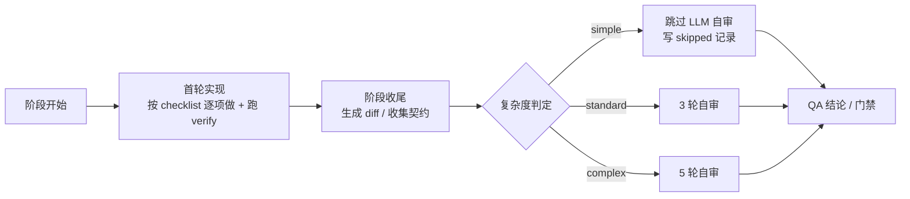

# 自审分档与代码审查策略

> 适用版本：2026-11-05（自适应自审上线后）
> 相关文档：`docs/plans/2026-11-02-多镜头自审方案与改动说明.md`、`docs/提示词与上下文组装说明.md`
> 本文回答：**简单 / 中等 / 复杂三档任务，在开发与自测阶段分别怎么审代码，什么时候走多镜头自审。**

---

## 一、一句话

复杂度由**编排层规则**在**每个阶段收尾**时判定（零模型调用）；`simple` 不跑 LLM 自审（走老逻辑），
`standard` 跑 3 轮，`complex` 跑 5 轮。开发阶段与自测阶段**各自独立判一次**，因为两者的改动面不同。

---

## 二、判定时机与输入

### 2.1 时机



- 判定发生在**首轮 `send()` 返回之后、自审之前**（`executor._run_review()`，`executor.py:1219`）；
- 不是「开发前估」，也不是「每一步审」——清单的逐项执行发生在 agent 自己的 loop 里，
  编排层只在阶段末看整体 diff。

### 2.2 输入信号

| 信号 | 来源 | 说明 |
|---|---|---|
| 改动文件数 | diff 解析；无 git 时用工作区文件清单 | 没绑仓库的任务（代码写在 `workspace/repos/`）靠兜底清单 |
| diff 增删行数 | 同上 | 无 git 时为 0，只按文件数与模块跨度判 |
| 模块跨度 | 文件路径归并 | 容器目录取第二层（`src/server/api.js → src/server`），其余取第一段（`public/js/app.js → public`）；`tests/docs/data/scripts` 与根级配置文件不算模块 |
| 高风险词 | brief + checklist + 改动路径 | 中文子串、英文单词边界（`auth` 不命中 `author`） |

代码：`src/sortie_deck/complexity.py`（`ComplexityLimits` 76 行、`estimate_complexity` 198 行、
`module_of` 150 行、`estimate_from_scope` 273 行）。

---

## 三、三档阈值（默认值，全部可配置）

| 档位 | 判定条件 | 自审轮次 |
|---|---|---|
| `simple` | 文件 ≤ 3 **且** diff ≤ 500 行 **且** 单模块 **且** 未命中高风险词 | **0**（老逻辑） |
| `standard` | 未命中 `simple`，也未命中 `complex`（最多 10 文件、1500 行） | **3** |
| `complex` | 文件 ≥ 11 **或** diff > 1500 行 **或** 跨模块 ≥ 3 **或** 命中高风险词 | **5** |

边界示例：

| 场景 | 判定 |
|---|---|
| 3 文件 / 500 行 / 单模块 | `simple` |
| 4 文件 / 500 行 | `standard` |
| 10 文件 / 1500 行 | `standard` |
| 11 文件 / 10 行 | `complex` |
| 1 文件 / 1501 行 | `complex` |
| 3 文件跨 2 模块 | `standard` |
| 1 文件 / 10 行，brief 含「支付」 | `complex`（高风险词） |

高风险词默认：重构、迁移、并发、支付、权限、鉴权、多端、架构、协议、加密、审计、
refactor、migration、concurrency、payment、auth、oauth、jwt、encryption。

### 3.1 配置项（前缀 `TDT_`）

```bash
TDT_REVIEW_ADAPTIVE=true                          # 总开关；关掉即固定用 review_lens_rounds
TDT_REVIEW_COMPLEXITY_SIMPLE_MAX_FILES=3
TDT_REVIEW_COMPLEXITY_SIMPLE_MAX_DIFF_LINES=500   # 含 500
TDT_REVIEW_COMPLEXITY_COMPLEX_MIN_FILES=11        # >=11 判复杂
TDT_REVIEW_COMPLEXITY_COMPLEX_MIN_DIFF_LINES=1500 # >1500 判复杂
TDT_REVIEW_COMPLEXITY_COMPLEX_MIN_MODULES=3
TDT_REVIEW_COMPLEXITY_HIGH_RISK_KEYWORDS=...
TDT_REVIEW_ROUNDS_SIMPLE=0
TDT_REVIEW_ROUNDS_STANDARD=3
TDT_REVIEW_ROUNDS_COMPLEX=5
```

配置代码：`settings.py:194-210`。

---

## 四、三档在开发 / 自测阶段分别怎么审

| 档位 | 开发阶段（`eng_implement` / `eng_web` / `eng_backend` …） | 自测阶段（`eng_*_selftest`） |
|---|---|---|
| **simple** | 不跑多镜头自审。质量网：契约校验（`implementation.md` / `tasks.json` / `diff.patch`）+ 清单逐项真跑 verify（写 `selftest_log.json`）+ 直接进自测 | 同上，0 轮。自测阶段通常只产 `selftest.md`（1 文件、几十行、单模块），天然是 simple |
| **standard** | 3 轮：正确性与不变量 → 空值与边界 → 测试缺口。前两轮允许就地修，测试缺口轮只记录 | 多数仍是 simple；若自测阶段真改代码导致超阈值，按实际 diff 升到 3 轮 |
| **complex** | 5 轮：正确性 → 边界 → 并发 → 安全 → 测试缺口 | 按自测阶段自身 diff 判定，多数 simple/standard |

三档的**机器验证完全一样**：清单每一项都必须真跑验证命令、记录 `exit_code`，失败项不许打 `[x]`。

代码：清单执行提示词 `executor.py:499`（`_checklist_exec_section`）；视角选择 `review_lens.py:234`。

---

## 五、什么时候真的会走多镜头自审

必须**同时**满足六条：

1. `TDT_REVIEW_LENSES_ENABLED=true`（默认开）；
2. 阶段在档位内：`TDT_REVIEW_LENS_STAGES=build,selftest`（`review_lens.py:225`）；
3. 首轮 `reply.status=ok` 且有文本（首轮失败 → 只留 skipped 记录）；
4. 复杂度 ≥ `standard`（simple 直接跳过）；
5. harness 不是 `mock`（mock 不产生真实改动）；
6. **阶段预算够**（见下一节），否则整段跳过。

---

## 六、预算兜底：复杂任务也可能被跳过

```57:77:/Library/git-root/sortie-deck-todos/src/sortie_deck/harness_providers/executor.py
    remaining = total - (time.monotonic() - started) - _REVIEW_TAIL_RESERVE_SECONDS
    if remaining <= _REVIEW_MIN_ROUND_SECONDS:
        return None
    per_round = min(timeout, remaining / max(1, rounds))
    if per_round < max(_REVIEW_MIN_ROUND_SECONDS, timeout * 0.5):
        return None
    return per_round
```

按默认值（编码阶段超时 3600s、claude_code 单轮超时 900s、预留 60s）推算主体回合可用的时间上限：

| 轮次 | 每轮最低要求 | 主体必须在…内跑完 |
|---|---|---|
| 3 轮 | 450s（自适应值的一半） | 3600 − 60 − 1350 = **2190s ≈ 36.5 分钟** |
| 5 轮 | 450s | 3600 − 60 − 2250 = **1290s ≈ 21.5 分钟** |

超过上限 → 整段跳过，`review.json` 记 `verdict=not_run`、
`reason="阶段剩余预算不足，跳过自审"`（`review_lens.py:854`）。
**注意**：`complex` 档 5 轮比 3 轮更容易被跳过；希望复杂任务更常真跑自审，
可调大 `TDT_ENG_STAGE_TIMEOUT_SECONDS` 或把复杂档轮次调回 3。

---

## 七、各档的产出与失败处理

| | simple | standard | complex |
|---|---|---|---|
| 额外模型请求 | 0 | 3 | 5 |
| `logs/<stage>/review.json` | 有（`not_run` + reason + complexity） | 有（逐轮 lens） | 有（逐轮 lens） |
| `logs/<stage>/review.jsonl` | 无 | 每轮一条 | 每轮一条 |
| `artifacts/<stage>/review.md` | 无（不产假报告） | 有（仅真正跑过） | 有 |
| `meta.review` | `{verdict: not_run, reason, complexity}` | 完整摘要 | 完整摘要 |
| blocking 处理 | — | `review_blocking_policy`：`hitl`（默认）/`fail`/`ignore` | 同 standard |

写盘：`run_review_lenses`（`review_lens.py:690`）、`build_skipped_log`（`review_lens.py:854`）、
`render_review_markdown`（`review_lens.py:955`）。

---

## 八、simple 不是「没人看代码」

简单任务省掉的是**阶段内多轮 LLM 复审**，质量责任转移到三处：

1. **逐项 verify**：清单每一项必须真跑验证命令，记录 `exit_code` 与输出尾部到 `selftest_log.json`；
2. **契约校验**：`implementation.md` / `tasks.json` / `diff.patch` 缺件、为空、非本轮产物都判失败；
3. **QA 独立裁决**：`qa_verify` 按 `acceptance.json` 逐条验证，fail 会打回 `eng_implement` 重做。

---

## 九、每个阶段的判定是独立的一次

- 开发阶段：看本阶段真实改动 → 可能 simple / standard / complex；
- 自测阶段：只看自测阶段自己的 diff（通常只有 `selftest.md`）→ 多数 simple；
- 自测阶段若顺手修了 bug、文件数/行数上升 → 自动升级到 standard / complex，不需要人工改配置。

---

## 十、观测与调参

1. `logs/<stage>/review.json` → `complexity.level` / `score` / `signals`（files、diff_lines、modules、high_risk_hits、当次阈值）；
2. `StageResult.meta.review.complexity` → 工作台/日志直接看；
3. 时间线 `review_skip` 事件 → simple 跳过或预算不足都会留一条；
4. 一周后按 `level` 分布与 `review` 的 blocking/degraded 比例调阈值（只改 `TDT_REVIEW_*`，无需改代码）。

---

## 十一、代码索引

| 主题 | 位置 |
|---|---|
| 复杂度判定 | `src/sortie_deck/complexity.py`（`ComplexityLimits` 76、`estimate_complexity` 198、`estimate_from_scope` 273） |
| 轮次与视角 | `src/sortie_deck/review_lens.py`（`ReviewConfig` 130、`rounds_for` 143、`select_lenses` 234） |
| 档位判定 | `src/sortie_deck/review_lens.py:225`（`stage_in_review_scope`） |
| 审查范围 | `src/sortie_deck/review_lens.py:457`（`build_scope`，含无 git 兜底） |
| 自审接入 | `src/sortie_deck/harness_providers/executor.py:1219`（`_run_review`） |
| 预算兜底 | `src/sortie_deck/harness_providers/executor.py:57` |
| 配置 | `src/sortie_deck/settings.py:194-210` |
| 测试 | `tests/test_complexity.py`、`tests/test_review_lens.py` |

---

## 十二、变更记录

| 日期 | 变更 |
|---|---|
| 2026-11-02 | 多镜头自审上线（3 轮，固定） |
| 2026-11-05 | 自审范围兜底（无 git 差异按工作区文件推断）、跳过原因进顶层 |
| 2026-11-05 | 自适应分档：simple 0 轮 / standard 3 轮 / complex 5 轮，阈值可配 |
| 2026-11-05 | 阈值校准：simple ≤3 文件且 ≤500 行；standard 至 10 文件 / 1500 行；超出为 complex |
